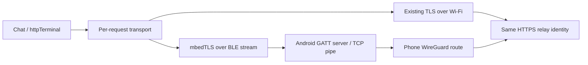

# Android BLE relay path — design and implementation contract

Status: implementation scope approved, 2026-10-15. Server mode remains a
selectable system configuration option. P4/C6 is the first qualification target;
phone-only central mode is required alongside G2/client mode. Work proceeds on
`codex/android-ble-relay`; commits and publishing remain separate review steps.
Protocol values below are the v1 contract; implementation-driven corrections
must be recorded here before Android implementation consumes it.

Original implementation checkpoint (before hardware qualification): the
production BLE runtime and both HTTP consumers
are integrated. Chat and httpTerminal use a shared Wi-Fi-first transport with
strict mbedTLS over the phone pipe, independent request lifetimes and a sticky
no-replay boundary. Phone-only builds expose both consumers with G2 disabled;
Server mode stays selectable. Host tests cover protocol/security/lifetime logic,
actual pinned HTTP header writes, and the real linked mbedTLS source with a
bounded fake byte pipe. Android interoperability and RPA rotation/reboot,
TLS parity on P4 and display coexistence still require qualification. A passing
host test or firmware build does not establish those hardware properties.
At that checkpoint, physical qualification was deferred until an Android pipe
app existed, and no firmware had been flashed. Subsequent qualification and
changes are recorded below.

| Validated P4 profile | Application bytes | Free application bytes |
| --- | ---: | ---: |
| Phone-only, G2 disabled | 5,080,656 | 2,345,392 |
| G2 plus phone | 5,938,656 | 1,487,392 |
| Existing baseline, pipe disabled | 5,882,864 | 1,543,184 |

All use the existing 7,426,048-byte application partition. These are flash
measurements from the final software build, not runtime heap measurements.

## Staged review checkpoint — 2026-10-15

Work is based on firmware `c0384687` with uncommitted staged fixes. Each stage
requires review before the next; no commits are authorized and each flash needs
separate approval. Stage 2 was reviewed and approved; stage 3 was accepted subject
to the ring-policy correction recorded below. The camera-off combined candidate
has now been flashed with approval; see the live qualification below. Stage 4 is implemented and host/build validated, pending user review. The user
authorized stage 5 while that review continues; stage 5 is now host/build validated
and stopped for review below. The user then authorized stage 6, now complete
and stopped for review at its checkpoint below. D5 relay heartbeat is unchanged. D3b (dedicated pipe passphrase), D9
(Arduino DISCONNECT patch) and D11 (factory reset clears pipe secret) are selected
for stage 4. The design and Android handoff now carry that contract; Android
application implementation and device interoperability remain unqualified.

Stage 1 completed three camera-off runs of 780 seconds each, beyond the prior
613-second failure point: 78 USB probes and 78 replies, no observed USB silence
or watchdog reset. Saved Wi-Fi rejoined and HTTP started on each boot. The user
confirmed web reachability from the isolated network while USB was healthy;
this Mac could not reach that network. No silence event occurred, so web behavior
during USB silence remains unobserved. Login-gate replies qualify USB RX/main-loop
admission/TX, not authenticated commands or phone traffic. The result implicates
the camera path or its resource/timing interactions but does not establish the
root defect or camera-enabled stability. No JTAG attachment or additional flash
occurred during these runs; the diagnostic image was already flashed with approval.

Stage 1 validation: 14 selected registered host suites and nine standalone
phone/transport suites passed. Both requested profiles built: `p4-phone-pipe`
5,944,624 application bytes / 1,481,424 free; `p4-openclaw` 5,883,584 / 1,542,464.

Stage 2 removes the D4 application clock gate and session-ticket override,
requires internal RAM for the phone TLS state, and fixes direct TCP readiness
before TLS or plaintext connection success. Direct polling uses fresh select
sets, SO_ERROR, cancellation and the existing overall two-second connect budget.
The pinned SDK's stale-set path is bypassed only after confirmed TCP readiness;
the socket remains nonblocking. Trust failures still cannot trigger fallback,
and the existing HTTP no-replay boundary is unchanged.

The linked P4 `PhoneTls` object is 1,296 bytes per active request (2,592 for two),
plus allocator overhead, released on close. This is object-size accounting, not
runtime heap measurement. Larger mbedTLS allocations retain the existing SDK
allocation policy. Internal allocation failure rejects the request without a
PSRAM fallback. Certificate chain and hostname/IP verification remain required;
date and ticket behavior follow the existing SDK configuration, as detailed below.

Stage 2 validation: seven host suites passed with ASan/UBSan, including the
pinned ESP-TLS state-machine regression, pinned HTTP open/header test, worker
lifecycle/integration checks and 18 real-mbedTLS certificate/fragment cases.
The delayed-connect regression fails against the original implementation.
Both profiles have identical mbedTLS configuration choices. Live Wi-Fi requests,
phone interoperability, hardware crypto and the full certificate parity matrix
remain unqualified by these host results.

| Stage 2 P4 profile | Application bytes | Free application bytes |
| --- | ---: | ---: |
| `p4-phone-pipe` | 5,945,072 | 1,480,976 |
| `p4-openclaw` | 5,883,520 | 1,542,528 |

Both builds passed using the 7,426,048-byte application partition. Private logs,
image/ELF hashes and soak evidence are retained outside public documentation.
The active build directories are retained for subsequent staged work and installed
image symbols; disposable native test builds and fixtures were removed.

### Stage 3 — shared link admission and stuck-phone recovery

The shared coordinator reserves capacity before glasses/ring client creation or
phone scanning/GATT registration. Reservations cover pending setup, established
links and clients still awaiting confirmed retirement. Admission uses the smaller
of four, the host ACL configuration and the C6 reported/assumed capacity. The ring
yields below four slots only while the phone pipe is enabled at runtime, even
when another slot is currently free. A compiled-out or stopped pipe preserves
glasses-plus-ring operation on a three-link controller. Phone admission
in the glasses role reserves room for both arms. A refusal allocates no client,
issues no connection request and never reaches wedge-streak accounting.

Ordinary phone retirement still attempts bounded cancel/close/unregister and
security-policy restoration. If cleanup remains incomplete after four seconds,
the phone releases the shared setup mutex, closes new central admissions and
requests recovery. It retains its native GATT object and link reservation for
late callbacks. Normal late completion can still retire it without a restart.

Recovery runs in the main-loop role owner, outside BLE callbacks and the phone
worker. The worker must acknowledge quiescence within one second; the G2 and
ring owners must also quiesce through their existing bounded stop APIs. Only then
is a Bluetooth host restart logged and attempted as a last resort. Confirmed
terminal HAL teardown permits release of native ownership and capacity. The
original central role is restored only if user intent still allows it; reconnect
requests pass through the existing peer authority/disconnect fences. There is one
recovery attempt per incident and at least ten minutes between host restart
attempts. Unsafe or failed teardown leaves Bluetooth blocked with a logged reason;
no restart loop, deletion of an active worker or device reboot is introduced.

Four earlier reporting/admission claims were corrected in the firmware changelog,
companion pin header, HAL capacity API comment and companion README. Reporting
controller capacity alone did not enforce it; the coordinator now owns enforcement.
D5 heartbeat remains unchanged. This stage 3 checkpoint precedes the stage 4
D2/D3/D9/D11 implementation recorded below; Terminal work remains stage 5.

Stage 3 validation: nine host suites passed (ASan/UBSan on eight native suites;
one configuration-preprocessor suite). Coverage includes concurrent reservations,
capacity refusal before client/connect dispatch, stuck and late GATT retirement,
ten recovery transaction scenarios, G2 lifecycle and BLE server-stop regression.
The source and host tests do not qualify live controller recovery or radio load.

| Combined stages 2 + 3 P4 profile | Application bytes | Free application bytes |
| --- | ---: | ---: |
| `p4-phone-pipe` | 5,948,400 | 1,477,648 |
| `p4-openclaw` | 5,884,784 | 1,541,264 |

Both requested builds passed. Nothing was committed or flashed. The next
separately approved flash must include stage 2 so one chat over home Wi-Fi can
qualify the direct-connect fix; that live request has not yet been tested.
The installed camera-off diagnostic is unchanged. Stage 1's three 780-second
runs passed, but web response during USB silence remains unobserved because no
silence occurred. Temporary native builds were removed; existing active firmware
build directories and private evidence remain for the staged work.

### Stage 3 correction — ring yields only while the pipe is enabled

D1 now gates ring scan/connect admission on runtime pipe enablement as well as
controller capacity. A compiled-out or stopped pipe permits both glasses arms
and the ring on the existing three-link C6. Starting the pipe cancels ring setup
and retires an existing ring client through its owner, preserving user reconnect
intent. A busy writer delays retirement; incomplete native retirement retains
capacity until completion. The phone cannot reuse that slot early. Stopping the
pipe restores ring admission. A four-link controller can retain all four peers.

Ten host suites passed (nine native suites with ASan/UBSan and one configuration
suite). New coverage exercises the production ring-yield function with pipe
compiled out, runtime off, enabling while all three slots are occupied, writer
contention, late retirement, stopping the pipe and four-link coexistence. The
coordinator and phone-runtime suites also cover policy publication and admission.
These results do not yet qualify behavior on the physical controller.

A camera-off qualification profile is derived from `p4-phone-pipe` by changing
only `ENABLE_CAMERA_SENSOR=0`; glasses, ring, phone pipe, HTTP and STT remain
compiled in. It includes stages 2 and 3 plus this correction. This is distinct
from the older camera-off diagnostic, which disabled G2. The camera fault remains
a separate unresolved track; no camera fix is included in this pass.

All three builds passed:

| Current P4 profile | Application bytes | Free application bytes |
| --- | ---: | ---: |
| `p4-phone-pipe` | 5,948,784 | 1,477,264 |
| `p4-openclaw` | 5,884,896 | 1,541,152 |
| `p4-phone-pipe-camera-off-test` | 5,636,096 | 1,789,952 |

### Stage 3 live qualification — approved P4-only flash

The user approved the exact camera-off candidate. Only the P4 application at
0x10000 was written; esptool verified the data hash. The C6 firmware, bootloader,
partition table and data partitions were not flashed. Both requested standard
builds remain build-only results. No commits were made.

One direct Wi-Fi chat completed with the expected test reply. Wi-Fi was connected
and the phone pipe was stopped before submission, excluding phone fallback.
`c6status` reports: `BLE links: 3 (companion does not report its limit, this image
is built for 4)`. This is the conservative assumed limit, not a new controller
capability report.

After the user released the right temple from the phone, both glasses links
connected concurrently. With the pipe stopped, the ring reached BLE/GATT setup
but its reported firmware `2.3.2.0007` was rejected as `profile-unknown`. The
existing R1 profile table recognizes `2.2.7.0005` and `2.2.9.0003`; that table is
unchanged from the base revision. Thus sustained glasses-plus-ring coexistence
and yielding from a fully connected ring remain unqualified. No protocol-profile
bypass or ring firmware change was made.

With the phone pipe enabled, a ring request logged that it yields to the enabled
pipe below four links; both glasses links stayed up. This qualifies live admission
refusal, not the blocked connected-ring transition. Temporary diagnostic verbosity
was restored to off, and the pipe was stopped after this check.

The initial Terminal attempt stopped at unavailable glasses firmware metadata.
After the user reported Terminal open, the device confirmed `idle` with both
glasses links up, Wi-Fi connected and the phone pipe stopped. The Terminal host
session load/open check therefore passes: the implementation accepts valid HTTP
200 responses before native open and sync completion can reach idle. This is
state-based verification, not a raw HTTP response capture. No firmware-query
bypass or additional chat submission was used. Terminal was left open in the
user's current state. The status reason retains `loading-host-sessions` after
completion; that reason string alone does not indicate an outstanding request.

Full captures and address/credential-bearing evidence remain private. The camera
fault remains separate and unfixed. Stop for review before stage 4.

## Stage 4 contract — D2/D3/D3b/D9/D11, 2026-10-15

Stage 4 replaces the former SMP enrollment and write-with-response pipe. The
firmware implementation and revised Android contract are ready for review;
physical Android interoperability has not been qualified.
Stage 5 Terminal R8/R9 has its separate review checkpoint below; stage 6 suite
registration remains pending.
D5 relay heartbeat and the camera fault remain unchanged.

RX requires WRITE_NO_RESPONSE; TX requires NOTIFY; CCCD uses a normal write
request. All three attributes require no SMP authentication. The P4 never
requests encryption, sets global SMP policy or creates/removes a phone bond.
Android must not call createBond/removeBond. Discover by advertised service UUID;
addresses (including RPAs) are only connection hints, never authorization.

Use a dedicated `phonepipesecret`, provisioned by a superadmin through a
non-Bluetooth command source, with the same passphrase-strength rules as
`blesecret`, bounded to 128 UTF-8 bytes after trimming outer whitespace. It is an encrypted isSecret setting. Cached PSK and live channel
keys must use internal RAM. Changing/clearing it drains the pipe and invalidates
its enrollment. Factory reset clears this secret durably before deleting the
accounts; accessory bonds and the console secret retain their existing policy.

The phone initiates the console Secure Channel v1 handshake; P4 responds.
The messages are unchanged: HELLO `01 || appPub[32] || appNonce[16]`, HELLO_ACK
`02 || devicePub[32] || deviceNonce[16]`, CONFIRM `03 || ct[2] || tag[16]`,
CONFIRM_ACK `04 || ct[2] || tag[16]`, REJECT `05 || reason[1]`. CONFIRM plaintext
is ASCII `ok`. P4 uses REJECT reason `02` for handshake authentication/protocol
failure, best-effort for at most 250 ms before closing. Missing secret prevents
pipe startup, so no connection is opened to emit reason `01`. Use PBKDF2-HMAC-SHA256, 100000 iterations, 32 bytes, with salt
`HW1-PIPE-v1`; HKDF-SHA256 input `X25519 shared || PSK`, salt
`appNonce || deviceNonce`, info `HW1-PIPE-v1`, output 64 bytes. First 32 are
phone-to-P4, last 32 P4-to-phone. ChaCha20-Poly1305-IETF has no AAD. Nonce is
big-endian direction[4] (0 phone-to-P4, 1 P4-to-phone) || counter[8]. Confirmation
uses counter zero; DATA starts at one and strictly increases independently in
each direction. There is no resumption. All failures clear keys and close.

Android sends HELLO immediately after CCCD enable. Finish both confirmations
within five seconds of subscription. P4 submits pipe HELLO only after a valid
CONFIRM and successful local CONFIRM_ACK submission; Android accepts it only
after verifying CONFIRM_ACK. Neither endpoint opens TCP before authentication
and normal pipe HELLO/HELLO_ACK. A failed handshake imposes a global 30-second
cooldown on P4, regardless of advertiser address. Android applies the same
attempt limit per central.

Every complete pipe frame (12-byte header plus body) is encrypted as exactly
one DATA value: `10 || counter[8] || ciphertext || tag[16]`. No console 5-byte
application-fragment header is included. Pipe header/body integers remain little
endian; secure counters/nonces are big endian. Plaintext after the handshake,
bad tags or counter regression terminate the entire session.

Let physical GATT value limit be V=min(MTU-3,512). Require MTU >=64; reject a
smaller negotiated MTU before subscription. The pipe HELLO max_value is P=V-25,
and DATA body limit is P-12. At MTU244, V241/P216/body204; at MTU247,
V244/P219/body207; at MTU517, V512/P487/body475. All existing inner sequence,
credit, stream, cancellation and no-replay rules remain. Write completion means
local stack completion, not a peer ATT response; use WRITE_NO_RESPONSE, one
pending local write, bounded deadline and the accessory-priority TX gate.

Enrollment remains an explicit local operation tied to the requesting session,
but proves the dedicated key instead of a bond or six-digit comparison. Persist
only app-channel enrollment version 1 after the authenticated pipe is ready.
Ignore old bond metadata for reconnect authority. Forget drains the pipe and
clears this enrollment, preserving console ownership/address and unrelated bonds.
The phone's target allowlist is explicitly configured for this app channel.

D9 changes a foreign BLEClient DISCONNECT from switch-break to function-return
before remote service fan-out. Shared application IDs wrap within 0..32767 and
skip reserved/live/quarantined registrations under the registry lock. Release
only after registration failure, confirmed UNREG or verified host shutdown.

Android implementation must consume this revised contract before interoperability
qualification. This firmware task changes only the design/handoff, not Android,
relay behavior, firewall or companion firmware.

## Stage 4 validation — ready for review, not flashed

Implemented D2/D3 with D3b, D9 and D11. RX uses WRITE_NO_RESPONSE with bounded
local completions and shared pacing. The dedicated-key secure channel replaces
phone SMP enrollment; console crypto primitives are shared without changing its
wire protocol. Old pipe identity helpers/tests and the Arduino SMP-policy API
are removed. Factory reset uses the existing checked settings writer, explicitly
removing pipe secret/enrollment fields even when a disabled module's old settings
would otherwise be preserved by merge. Console and accessory records remain.

24 selected host suites passed, with ASan/UBSan on 21 compiled suites and three
configuration/source-contract suites. These cover pipe framing, real crypto and
independent KDF vectors, native GATT, runtime/cooldown, enrollment schema/authority,
secret command/storage, SDK lifetime, factory reset and settings persistence,
console channel regression, capacity/ring/recovery, server/G2/companion lifecycle,
and the already-present native QuickNote adapter. Seven SDK checker cases pass;
the incremental patch reproduces all five manifest hashes, and the baseline
Arduino patch verifier passes. One stale source guard expected `targetChanged`
in unchanged pre-existing peer setters; it now checks their actual conditional
`applied.persistenceChanged` persistence call. Behavioral persistence suites pass.
New suite registration remains stage 6.

| Profile | App bytes | Free app bytes |
| --- | ---: | ---: |
| p4-phone-pipe | 5,958,832 | 1,467,216 |
| p4-openclaw | 5,898,448 | 1,527,600 |

Both are normal camera-enabled saved profiles, built from `c0384687` plus the
uncommitted working tree, including the pre-existing ring and native QuickNote
changes. They are not a new camera-off flash candidate. The approved stage 3
camera-off image and its matching build directory were not overwritten.

Internal-RAM observations from the linked P4 map: the shared SDK ID bitmap is
4096 bytes (also present with pipe disabled); the cached pipe PSK is 32 bytes;
the phone GATT owner grows by 192 bytes versus the stage 3 camera-off map
(28,336 to 28,528 bytes). The configured passphrase needs at most 129 heap bytes
plus String/allocator overhead. These are component allocations, not a measured
net free-heap change or a runtime stack/heap qualification. The phone worker uses
its existing 8192-byte internal stack; no new worker was added.

No stage 4 commit or flash. Android wire compatibility, G2 hardware regression,
rotation/reboot and RF/load behavior remain unqualified. D5 and the camera fault
remain separate. Stage 4 review remains open; the user separately authorized
stage 5 below.

## Stage 5 — firmware Terminal admission and polling, ready for review

Stage 4 remains under review. The user explicitly authorized stage 5 in parallel;
this checkpoint implements firmware R8/R9 only. Relay, Terminal-host and Android
runtime code are unchanged, as are D5 and the camera track. No commit or flash.
Stage 6 remains pending.

The shared HTTP transport reserves one request/pipe slot for chat and one for
Terminal before either worker starts. A reservation is reusable only after its
worker releases it and its stream retires on CLOSE_ACK, RESET or OPEN_ERR (or
session loss). A peer CLOSE keeps the stream until our ACK is submitted. Failed
OPEN retains its handle through cleanup; it cannot silently free a closing slot.
CLOSE still has the existing 2-second deadline, which invalidates the entire
pipe session on expiry. This does not add stream replay or a heartbeat change.

`httpTerminalStart` returns Accepted, Busy or Unavailable synchronously. Both
refusals leave token zero and start no worker. Busy retries silently without
closing native Terminal. List/poll can continue waiting. Every other Terminal
operation records its confirmation time; its Busy wait is at most 15 seconds,
including time spent queued behind a poll or a native acknowledgement. The
original timestamp/path availability survives deferred ASR and choice gestures.
Unavailable drops the operation with `Not sent: no connection`. Busy expiry
shows `Not sent: connection busy for 15 s`. Both retain the native view and
reviewed transcript. A restored path cannot resurrect the dropped mutation;
another explicit wearer action is required. Session selection retains the old
view identity until the host accepts the new selection.

On the phone path the result carries its completion time, after HTTP/transport
cleanup. The next poll waits at least 2 seconds for a busy/awaiting host and
3 seconds for an idle host. `more` removes that time delay, but admission still
waits for the previous stream's retirement. Wi-Fi keeps its existing 500 ms
cadence, including its draft/listening behavior. These admission delays are
separate from the unchanged 15-second HTTP worker deadline.

A relay 503 displays exactly `relay busy with an earlier request (outcome unknown)`.
It keeps the view and transcript and does not retry. Automatic polls pause until
another explicit operation or reopening the view, avoiding an implicit repeat
of the failed request. Notices wait behind an in-flight native content ACK and
never overwrite a live ASR buffer. No claim is made that the earlier host
operation failed or was cancelled.

Validation: 12 selected host suites pass, with ASan/UBSan on 11 compiled suites
and the phone-pipe configuration contract check. These cover native Terminal,
HTTP worker/stream/integration, shared transport, pinned SDK HTTP opening and
direct connect, real configured mbedTLS, pipe protocol, phone runtime and GATT.
The required offline-confirmation/20-second-recovery test sends zero prompts.
The chat-active/Terminal-awaiting-CLOSE_ACK test admits the next poll only after
ACK and keeps native Terminal open. Tests also cover reversed ACK/worker-release
order, failed OPEN, OPEN_ERR during cancellation, peer CLOSE ACK submission,
15-second Busy expiry, deferred offline confirmation, completion-based polling,
unchanged Wi-Fi cadence, and a non-JSON 503 with no automatic retry. Seven SDK
checker cases and both Arduino patch checks pass. New-suite registration is
still stage 6.

| Profile | App bytes | Free app bytes |
| --- | ---: | ---: |
| p4-phone-pipe | 5,960,752 | 1,465,296 |
| p4-openclaw | 5,900,080 | 1,525,968 |

Both images use the normal camera-enabled saved profiles and include stage 4.
The approved stage 3 camera-off image/build remains untouched; these are not new
flash candidates. Physical Android/pipe interoperability and wearer/RF timing
remain unqualified until an approved flash and live tests.

The linked phone-pipe image adds 24 bytes of internal static reservation state.
The native Terminal state grows by 120 bytes in PSRAM (15,800 to 15,920 bytes).
These are component-level symbol measurements, not net runtime free-heap data.
No extra task, TLS object or pipe buffer is added. Existing build directories
are reused. Matching stage 4 review images/debug files are retained privately
(181 MiB) while that review is open; no full build snapshot was created.

The isolated stage 5 patch, hashes, build/test logs and validation manifest are
in the firmware checkout's ignored
`tools/p4/companion/private/console-debug-2026-10-15/stage5/` directory.
Stop here for user review before stage 6. Do not flash without separate approval.

## Stage 6 — test registration, 2026-10-16

The user authorized continuing after the stage 5 checkpoint. Stage 4 remains
under review; stage 6 changes only host-test registration, documentation and two
stale test boundaries. No firmware runtime, relay, Terminal-host, Android, D5,
C6 or camera behavior changed. No commit or flash.

The existing host CMake owner now registers 19 previously standalone suites.
Together with the existing native Terminal codec/adapter and HTTP worker suites,
`ctest -L phone_pipe` selects 22 tests when configured with
`HW1_PHONE_TEST_IDF` and `HW1_PHONE_TEST_SDKCONFIG`. Five SDK/crypto tests also carry
`phone_sdk`. Without those options, 17 tests remain registered and CMake reports
which additional tests need explicit dependencies. The TLS test uses the actual
generated device header; no synthetic TLS policy is substituted. Invalid
explicit SDK/header paths fail configuration. `HW1_SANITIZE` is forwarded to
all 19 compiled suites. The three Python/configuration checks do not take it.

The first registered run found two test-only compile failures: the shared G2
reader/Terminal transport stub had not followed the native QuickNote context
parameter, and the R1 harness lacked `<initializer_list>`. The stub now accepts
an opaque context pointer and asserts that reader/Terminal tests do not supply
one; native QuickNote retains its separate suite. Both repairs pass, including
the reader regression that shares the stub. The obsolete SMP identity suite
remains absent; native QuickNote was already registered and was not duplicated.

Validation: the final registered group passes all 22 tests with sanitizers
where supported, including seven checker cases inside `phone_sdk_checker`.
The separate shared-stub reader regression also passes. CTest inventory checks
confirm unique names and sanitizer forwarding. Independent CMake configurations
verify the 17-test default, sanitizer-off behavior, explicit missing-dependency
messages and rejection of invalid SDK/header options.

| Profile | App bytes | Free app bytes |
| --- | ---: | ---: |
| p4-phone-pipe | 5,960,752 | 1,465,296 |
| p4-openclaw | 5,900,080 | 1,525,968 |

Both normal saved profiles build successfully using their existing directories.
No hardware test is implied. Existing stage 4 review/debug images and the
installed stage 3 camera-off image remain retained. The disposable host CMake
directory and test fixtures are removed after retaining inventory, CTest logs,
configuration-check results, image hashes and the isolated stage 6 patch under
the firmware checkout's ignored
`tools/p4/companion/private/console-debug-2026-10-15/stage6/` directory.
Stop for user review. A flash still requires separate explicit approval.

## Remaining firmware review corrections — 2026-10-16

This checkpoint supersedes earlier pending stage 5/6 statuses. Firmware R8/R9
and test registration are implemented; the current full phone group passes
22 CTest checks. Android end-to-end interoperability remains unqualified.

NO_RSP local completion `ESP_GATT_CONGESTED` (0x8f) is accepted without replay:
the pinned SDK has already enqueued the PDU. Separate congestion events own
pacing. GATT transport failure, write timeout, resource exhaustion and cancellation
during handshake do not charge authentication cooldown. Invalid authentication
and peer handshake expiry retain the global 30-second limit. No boot-time
cooldown applies without a recorded authentication failure.

Speech admission has task-scoped owned-allocation measurements and an internal
largest-block check. Its conservative cold/resident floors remain pending
hardware calibration, independent of unrelated network heap movement. The
allocation hooks use a bounded ledger and do not enable heap task tracking or
change the global malloc placement threshold. Terminal keeps the view after
speech refusal. Inference no longer changes global watchdog subscriptions;
existing periodic blocking yields allow idle work between completed stages.

The current Android handoff, including D2/D3 and Terminal admission/polling, is
[PHONE_PIPE_HANDOFF.md](../../hardwareone-idf/docs/PHONE_PIPE_HANDOFF.md). Firmware
build/runtime evidence is in [P4_RUNTIME_MEMORY.md](../../hardwareone-idf/docs/P4_RUNTIME_MEMORY.md).
No Android/relay/Terminal-host runtime or firewall change is included. D5 remains
unchanged. No commits are authorized; each flash still requires explicit approval.
The C6 stays at three links until a separately approved four-link qualification.
The camera fault remains a separate hardware track.

Final validation for this pass: p4-phone-pipe, p4-openclaw and the camera-off
candidate all build. The phone CTest group passes 22/22; speech/notes/RAM passes
6/6, with 4/4 final factory-reset/QuickNote/memory checks (one overlapping test).
QuartzNet passes four resident/diagnostic variants under sanitizers. Exact image
hashes and headroom are in the linked firmware memory report. The camera-off
candidate's linked internal heap start moves by 1,424 B relative to the installed
working image. It has not been flashed; P4 approval and physical tests remain.
No commits or index changes were made; feature review groups are recorded only.

## Goal and boundaries

Keep one relay URL, TLS identity, CA and bearer token on the device. Prefer direct
Wi-Fi; when that path cannot connect, carry the device's TLS byte stream through
an Android peripheral/GATT server and its WireGuard-routed TCP connection.
TLS terminates only on the device and relay. Android knows the destination,
traffic sizes and timing, but receives neither plaintext requests nor the token.

All P4 links remain central/GATT client links in G2 mode: left arm, right arm,
phone, and optionally the existing ring. No port forwarding, ESP WireGuard,
Bluetooth tethering, hotspot, or simultaneous P4 central/peripheral operation.
Relay changes, Android implementation and firewall changes are outside scope.
This document specifies the Android contract, not changes in its repository.
Private addresses, deployment information, credentials and captures are omitted.

Initial qualification targets P4/C6. Phone-only central mode must work without
connected glasses and without initializing G2 presentation workers; the pipe
feature must not depend on compiling the G2 application. Existing Server mode
and its console remain selectable in system configuration. Persisted mode values
0 (Server) and 1 (G2 client) retain their meanings; add 2 (Phone pipe client).
Preserve the legacy `blemode phone` alias for Server and use `phone-client` for
the new mode. All surfaces must expose the same three choices. Mode transitions
drain the current owner under the existing role token before starting another.
Selecting Server must not be overridden at boot by a saved phone reconnect flag.

## Findings that determine the design

Read against bridge revision `0f6633b` and firmware revision `395d5dfb`, including
their current working files. Firmware paths below are relative to the separate
HardwareOne firmware repository; code does not move into this bridge repository.

| Existing owner | Finding and consequence |
| --- | --- |
| `components/hardwareone/BLE_Peers.{h,cpp}` | Already has `BLE_PEER_PHONE`, currently metadata-only, plus generation-checked reconnect admission. Extend this owner instead of introducing a second reconnect service. Saved targets currently lack persisted address types/identity resolution metadata. |
| `BLE_CentralTx.{h,cpp}` | Already serializes short controller writes from G2/ring. Lock order is controller gate, then peer mutex. It is a mutex, not a priority scheduler; adding the phone without scheduling would risk display contention. |
| `G2_Glasses.cpp` | Owns scans, client lifetime, MTU negotiation, heartbeat/render pacing and a custom GAP handler. Its normal HIGH interval is 15 ms. Some interval evidence concerns another controller; it does not qualify P4/C6. |
| `G2_Ring.cpp` | A possible fourth ACL link. Two arms plus phone do not imply a spare connection when the ring is present. |
| Arduino `libraries/BLE/src/BLEDevice.cpp` | Has a client registry and checked deletion with callback/routing drain. Reuse it; never delete a client from a notification callback or reset BLE to recover only the phone. |
| `System_LLMHttp.cpp`, `System_LLMHttpTerminal.inc` | Separate workers may overlap. Both use `esp_http_client`, the same configured trust/token, disabled redirects/auth retries and socket-based cancellation. Admission/status currently depend on `WiFi.isConnected()`. |
| Local IDF `esp_http_client.c` | `esp_http_client_open()` connects **and sends HTTP headers**. Failure of `open()` does not prove that a request was unsent. |
| IDF HTTP client header | Provides `cfg.transport` behind `CONFIG_ESP_HTTP_CLIENT_ENABLE_CUSTOM_TRANSPORT`; the inspected P4 generated config does not enable it. TLS options configured on the built-in SSL transport do not automatically configure a supplied transport. |
| `Bluetooth.cpp`, `System_BleSecureChannel.*` | The console uses an application secure channel; that is distinct from BLE SMP bonding. Its host tests do not establish Android SMP/RPA interoperability. |
| `experiments/p4_ble_roles/SDK-FIX.md` | Historical SMP experiment; the phone app-channel no longer depends on its pairing backport. Accessory/console behavior remains separate. |

Existing uncommitted bridge and firmware edits belong to other work. This
implementation leaves relay, bridge Terminal runtime, Wi-Fi and ESP-NOW source
changes intact. Firmware boot and companion lifecycle integration uses narrow
edits around phone host ownership; later integration must preserve that baseline.

## BLE ownership, connection management and display protection

### Admission and lifetime

Add `BLE_PhonePipe` as the implementation behind the existing phone peer. Its
states are DISABLED, WAITING, SCANNING, CONNECTING, SECURING, DISCOVERING,
NEGOTIATING, READY, DRAINING and BACKOFF. READY requires the dedicated-key
application handshake, checked service/characteristics/CCCD, MTU >=64, and
successful inner protocol HELLO. A connected ACL alone is not availability.

Use one shared scan/connect coordinator for G2, ring and phone. The scanner and
GAP callback registration are shared resources; the phone must not replace G2's
callbacks. Extend the existing ownership seam to dispatch by peer/connection and
generation. Serialize scan, connection creation, discovery and security setup;
do not hold that coordinator through the lifetime of established streams.
Existing G2 scan behavior remains intact except for explicit coordinator hooks.

Priority is G2 recovery/setup first, then existing ring control/setup, then phone
discovery. Reserve capacity for both arms even when one is disconnected. Count
live and connecting ACLs, plus retiring clients whose routing is not drained.
Admit at most one phone and no more than the smaller of four, the host ACL
configuration and the C6 reported/assumed link capacity. The ring yields below
four slots only while the phone pipe is enabled at runtime. Enabling the pipe
retires an existing ring link before its capacity can be reused; stopping the
pipe restores ring admission. Builds without the pipe retain glasses-plus-ring
operation. Refusal precedes client creation and native connect, and is not a
wedge failure. Validate the C6 controller's actual
capacity as well as host `CONFIG_BT_ACL_CONNECTIONS=4`, multi-connection support,
GATTC application capacity and hosted buffer limits. A host define alone does
not establish the radio's capacity.

Use the peer registry's backoff, cancellation and intent/identity generations.
Phone discovery uses bounded passive scans of 2 s, a 30 ms window in a 100 ms
interval, only when G2 recovery/render work permits. Advertising must
put the service UUID in the advertisement, without requiring an active scan.
Reconnect reuses the peer registry's 5/15/45/90/180 s capped schedule; link loss
ends all streams. This preserves one reconnect owner and reduces repeated scans
while the phone is absent. Explicit connect remains available without waiting
for that automatic schedule; tune the schedule only from hardware evidence.
Explicit disconnect suppresses reconnect until explicit enable/connect. No
continuous busy scan. A new advertised address must prove the configured key;
it never gains authority from its address.

Stop scans before connect; route late results only to their original generation.
Discover afresh on reconnect/service change. The native phone adapter retains a
static callback owner and positively checks CLOSE/cancel and UNREG completion;
an incomplete retirement quarantines that owner rather than reusing it. Existing
G2/ring wrapper clients keep their checked deletion and callback/routing drain.
A normal phone failure retires only its own work. An undrainable registration
uses the stage 3 bounded recovery transaction: a verified and logged Bluetooth
host restart is the last resort, and may interrupt the accessories. Leaving client mode first
cancels streams and drains phone work before existing mode teardown proceeds.
Bound a reconnect connection attempt to 10 s, discovery to 3 s and each checked
CCCD/write completion to 2 s. The local enrollment window lasts 60 s; the
application handshake itself has 5 s after subscription. Deadline expiry retires
the attempt and schedules backoff. Only bounded cleanup failure reaches the
logged last-resort host recovery transaction.

### Scheduling policy

Initial **tuning hypotheses**, subject to board qualification:

| Phone state | Requested interval | Peripheral latency | Supervision timeout |
| --- | --- | --- | --- |
| Idle, no streams | 90–120 ms | 4 | 6 s |
| Active streams | 30–45 ms | 0 | 6 s |

Record actual negotiated parameters. Request active parameters before stream
traffic, return to idle after 5 s without streams, and rate-limit changes. If a
request is refused, use bounded pacing at the granted interval; do not relax G2
intervals to improve phone throughput. Never apply ring's temporary glasses
priority guard to routine phone traffic.

Extend the central TX gate with explicit G2 pending-work/heartbeat priority.
Phone sends at most one ATT value per admission and initially at most one per
30 ms; return immediately if the controller gate or a higher-priority claim is
busy. Release the gate after submission, **before** waiting for write completion,
credit, TLS, TCP or security. Use checked asynchronous completion keyed by
connection and operation generation, not a blocking wrapper call under the gate.
Pipe worker priority stays below display/heartbeat work. No TLS, socket I/O,
allocation-heavy parsing or semaphore waits in BLE callbacks.

Inbound notifications also consume radio/hosted bandwidth. The receive-credit
window is therefore part of display protection: grant 1 KiB initially per stream,
allow growth only to 4 KiB, stop renewing grants during image bursts, audio
pressure or G2 recovery. Already granted credit cannot be withdrawn. Android
also paces DATA notifications to one per 30 ms initially. Control frames have
reserved queue capacity, but remain bounded and share controller arbitration.

Prefer timely G2 traffic over pipe progress. If sustained contention threatens
G2 health, stop admitting streams and terminate the pipe with a resource error;
never reconnect/resend an HTTP request as recovery. The cost may be an uncertain
request outcome. There is no software-only guarantee of unchanged RF performance:
the hardware acceptance criteria below are a release gate.

## GATT pipe protocol v1 — Android implementation contract

### Service, attributes and MTU

The following private 128-bit UUIDs are fixed by this proposal:

| Item | UUID | Properties |
| --- | --- | --- |
| Pipe service | `b7e10000-6f7d-4b2e-a8c4-3d9f5021c6a0` | Primary service; advertised |
| RX, device → phone | `b7e10001-6f7d-4b2e-a8c4-3d9f5021c6a0` | Write without response only |
| TX, phone → device | `b7e10002-6f7d-4b2e-a8c4-3d9f5021c6a0` | Notify only, standard CCCD `0x2902` |

RX and CCCD require no SMP authentication. The application channel above gates
all pipe traffic. Reject reads, prepared/execute writes and nonzero write offsets;
v1 has no long writes, indications or separate data characteristic. RX uses only
WRITE_NO_RESPONSE. CCCD remains a write request. A single ordered queue in each
direction preserves secure and inner-frame ordering. Unsupported or malformed
RX commands close the session, since commands have no ATT response. For CCCD
requests, use request-not-supported (0x06), invalid-offset (0x07), or
invalid-attribute-value-length (0x0d), as appropriate. CCCD accepts only `01 00`
(enable) or `00 00` (disable); disable closes all streams and requires a new BLE
session and handshake.

Use the actual negotiated ATT MTU and reject values below 64 before subscription.
Physical value capacity is `V=min(MTU-3,512)`; secure overhead is 25 bytes, giving
inner capacity `P=V-25`. HELLO negotiates no larger than P, fixed for the session.
Inner body capacity is P-12: 24 at MTU64, 204 at MTU244, 207 at MTU247, and 475 at
MTU517. TLS records are independently split/reassembled across these frames.

### Frame header and ordering

Each authenticated DATA plaintext holds exactly one inner frame; no
concatenation, padding or trailing bytes. Inner multibyte integers are unsigned
little-endian; outer secure counters/nonces use big-endian. UUID strings above use
normal UUID notation, not little-endian integer notation.

| Byte offset | Size | Meaning |
| --- | --- | --- |
| 0 | 1 | Version, exactly `1` |
| 1 | 1 | Opcode |
| 2 | 2 | Stream ID; zero is session control |
| 4 | 4 | Direction-wide frame sequence, starting at 0 for each BLE session |
| 8 | 2 | Body length, exactly decrypted inner frame length minus 12 |
| 10 | 1 | Flags: `FIRST=0x01`, `LAST=0x02`; other bits zero |
| 11 | 1 | Reserved, zero |

The next sequence must equal the expected value, across all streams/control
frames in that direction. Sequence numbers detect gaps/duplicates, not replay
recovery. Do not wrap; close the session before exhaustion. No application-level
retransmission. A definite local failure *before* submission can retain a queued
frame; an uncertain submission/completion failure terminates the session.
Assign sequence and advance DATA `sent` only at successful local submission,
not when queuing, so discarding unsent queued DATA creates no sequence gaps.

DATA always uses flags 0 and a nonempty body of at most `P-12` bytes. All other
opcodes are control messages: even an empty control body uses FIRST|LAST. Larger
control messages are fragmented using FIRST, zero or more continuation frames,
then LAST; each fragment has its own sequence/header, same opcode/stream ID.
Control fragments must be contiguous in that direction. Allow one reassembly
buffer per direction, at most 272 bytes and a 2 s completion deadline. Reject
interleaving, extra FIRST, orphan continuation, unexpected lengths or overflow.

### Session and stream messages

| Opcode | Name / direction | Reassembled body |
| --- | --- | --- |
| `0x01` | HELLO, P4 → phone, stream 0 | `nonce:u64, max_streams:u8, reserved:u8=0, max_value:u16` |
| `0x02` | HELLO_ACK, phone → P4, stream 0 | `echo_nonce:u64, phone_nonce:u64, max_streams:u8, reserved:u8=0, max_value:u16` |
| `0x10` | OPEN, P4 → phone, stream nonzero | `receive_limit:u32, port:u16, address_type:u8, host_length:u8, host[host_length]` |
| `0x11` | OPEN_OK, phone → P4, same stream | `receive_limit:u32` |
| `0x12` | OPEN_ERR, phone → P4, same stream | `error:u16` |
| `0x20` | DATA, either direction | Opaque TLS bytes |
| `0x21` | CREDIT, either direction | `absolute_limit:u32` |
| `0x22` | FIN, either direction | `final_byte_count:u32` |
| `0x23` | CLOSE, either direction | `reason:u16` (0 normal, 1 cancelled) |
| `0x24` | CLOSE_ACK, either direction | Empty |
| `0x25` | RESET, either direction | `error:u16` |
| `0x30` | PING, either direction, stream 0 | `cookie:u32` |
| `0x31` | PONG, opposite direction, stream 0 | Matching `cookie:u32` |

HELLO begins only after security, discovery, MTU and CCCD completion. Nonces come
from a cryptographic RNG and are nonzero; echo must match. They label a fresh
session, not authenticate it. Local connection generations must additionally
reject callbacks from an old link. Each side offers `max_streams=2`; reject a
peer that cannot support two. HELLO_ACK chooses `max_value` no greater than both
local decrypted capacity P and HELLO's offer, at least 20. HELLO is framed at
the local decrypted limit P; ACK is framed at the chosen limit. No OPEN before ACK. No repeated
HELLO on an established session. A reconnect starts entirely new state.

Only the P4 opens streams. Allocate monotonically increasing nonzero 16-bit IDs,
never reused in a session. Permit two live streams, including opening/closing
streams: one chat and one Terminal request. A third request fails locally as
busy. Round-robin DATA between credit-eligible streams; control messages precede
the next DATA frame. Concurrent TLS connections are independent; never multiplex
two HTTP requests into one TLS connection. If IDs exhaust, drain and reconnect
between requests.

OPEN `address_type`: 1 = IPv4 (length 4, network-order address bytes), 2 = IPv6
(length 16, network-order bytes, no zone ID), 3 = ASCII DNS name (1–253 bytes,
lowercase A-labels, no trailing dot/NUL/path/userinfo). Port is 1–65535. Extract
the authority from the validated configured HTTPS URL, preserving that original
authority separately for HTTP Host and certificate identity. Do not pass the
URL path, token, CA or HTTP body in OPEN. A parser that cannot represent an
authority safely fails locally rather than changing the destination.

Android permits only the relay host/port explicitly approved for the dedicated
application channel. Key possession authenticates that channel; MAC addresses
and OS bonds do not authorize a target. Provision this allowlist from the device's
validated target with explicit local enrollment confirmation; no runtime target
learning from arbitrary OPEN frames. A later relay-target change requires an
explicit allowlist update, not a second home/away setting. Reject other targets
before DNS/TCP. Resolve DNS through the VPN-covered network; the device still
verifies TLS against its original configured hostname/IP. No HTTP proxy,
CONNECT handling, TLS termination, token injection or alternative endpoint.

OPEN_OK means a TCP connection is established and buffers allocated, **not** that
TLS or a request succeeded. Android attempts TCP connect once (3 s cap); no
socket reconnect, alternate route, stream resume or replay of buffered bytes.
OPEN_ERR retires that ID without DATA. On VPN loss, process death, BLE loss or
TCP error, close sockets and fail streams. Do not retain data for later delivery.
Before OPEN_OK, only OPEN_OK/OPEN_ERR and cancellation CLOSE/RESET are legal on
that stream. After OPEN_OK, DATA/CREDIT/FIN/CLOSE/RESET are legal; CLOSE_ACK is
legal only in closing state. A pending TCP-connect callback after cancellation
must close its new socket, never publish a late OPEN_OK. Ordinary stream
messages require a nonzero ID; RESET on ID zero terminates the whole session.

### Flow control and bounded memory

Each direction of each stream has independent `sent`, `received`, `consumed` and
`limit` byte counters starting at zero. Initial limits arrive in OPEN (phone's
send allowance) and OPEN_OK (P4's send allowance), between 1 and 4096 inclusive;
recommended initial value is 1024. DATA consumes credit by **body bytes only**.
Sender must satisfy `sent + body_length <= peer_limit` before submission.

Receiver sends CREDIT with a monotonically nondecreasing cumulative absolute
limit. A repeated equal value has no effect. It may advance the limit only when
storage has been freed, with `limit - consumed <= 4096`. A sender rejects credit
that decreases or exceeds `sent + 4096`. Never wrap counters; terminate before
32-bit exhaustion. Receipt beyond the granted limit is a session protocol error.

For phone → device, bytes are consumed when the mbedTLS receive BIO removes them
from the RX buffer. For device → phone, bytes are consumed when a partial TCP
write accepts them into the socket; this is **not** proof of relay receipt or
execution. Stop socket reads when the outbound buffer/credit is exhausted; stop
BLE DATA submissions when peer credit is exhausted. Limit every socket read to
available bounded space; never allocate based on peer lengths. Coalesce credit
updates after 512 bytes consumed or 100 ms, unless display policy withholds them.
No credit increase is required while display work has priority.

Reserve two 4 KiB byte buffers per stream per endpoint (TX/RX), 16 KiB total for
two streams; plus bounded frame/control queues. P4 pipe storage target is at most
24 KiB excluding mbedTLS, HTTP and task stacks. The phone-only P4 object files
currently contain 23,851 bytes of writable phone-owner/GATT static storage,
plus 117 bytes for the shared setup coordinator. This fits that target; it does
not measure total Bluetooth/TLS heap use or stack high-water marks. The pipe
worker additionally reserves an 8 KiB stack. Allocate before advertising
capacity in OPEN/OPEN_OK. Allocation failure returns NO_RESOURCES. TLS record
buffers can be larger than a credit window: the BIO must make partial progress
and never wait for a whole TLS record to fit.

Reserve eight control-message descriptors and reassembly storage independently
of DATA buffers. Coalesce pending CREDIT; CLOSE/RESET can discard queued DATA.
Control is not credit-controlled. On control queue overflow fail the session;
do not silently drop a control message or deadlock waiting for DATA credit.

Android validates each RX write command and copies it into bounded owned state
before processing it. WRITE_NO_RESPONSE commands have no ATT response; invalid
or unqueueable commands close the session. P4 has at most one outstanding local
RX command submission, paced by its SDK completion and congestion events. Local
completion is not a TCP/relay ACK. Android has one outstanding TX notification
submission and waits for `onNotificationSent` before submitting the next; that
callback is local completion, not remote application delivery. Failed/uncertain
completion ends the session, except the accepted P4 NO_RSP congestion status
specified above. Callback work must remain short and must not block on TCP.
Only requests that require an ATT response (such as CCCD writes) receive one.
Android's callback contract is described in the official
[GATT server callbacks](https://developer.android.com/reference/android/bluetooth/BluetoothGattServerCallback).

### EOF, close, errors and liveness

FIN is directional EOF after all preceding DATA; its byte count must equal the
receiver's count. After queued bytes drain, phone FIN becomes EOF at the P4 BIO;
P4 FIN becomes TCP `shutdownOutput` after queued TCP writes complete. Reverse
traffic remains allowed. No DATA after FIN in that direction. A TLS close-notify
remains opaque DATA; FIN never substitutes for TLS or HTTP completion checks.

CLOSE aborts any remaining traffic and closes the TCP stream in both directions;
the peer discards remaining buffers and sends CLOSE_ACK. Keep the protocol slot
until ACK, and its consumer reservation until the worker also releases it. On
the 2 s timeout close the BLE session to avoid uncertain ID lifetime.
RESET is terminal and requires no ACK; OPEN_ERR also retires its ID immediately.
Simultaneous CLOSE is allowed; each sends ACK. For IDs already retired, discard
late DATA/CREDIT/FIN/ACK/CLOSE/RESET without reviving a stream; ACK a late CLOSE.
Duplicate/nonmonotonic OPEN, an unknown future ID, or a sequence violation is a
session error. IDs are never recycled, so old frames cannot enter a new stream.

Errors are fixed numeric values, without free-text OS/network details:
`1 BAD_PROTOCOL`, `2 UNSUPPORTED_VERSION`, `3 NOT_AUTHORIZED`, `4 TARGET_DENIED`,
`5 VPN_UNAVAILABLE`, `6 DNS_FAILED`, `7 CONNECT_FAILED`, `8 CONNECT_TIMEOUT`,
`9 BUSY`, `10 NO_RESOURCES`, `11 TCP_IO`, `12 FLOW_VIOLATION`, `13 DEADLINE`,
`14 CANCELLED`, `15 DISPLAY_PRIORITY`. OPEN failures use OPEN_ERR; established
stream failures use RESET. A malformed frame, sequence/flow violation or failed
GATT completion fails all streams and disconnects (best-effort stream-0 RESET).
Other RESET errors affect only their stream. Never echo arbitrary received bytes
into errors or logs. Unknown opcode/version/flags fail closed.

PING/PONG use no stream credit. While streams exist, send PING after 5 s without
inbound frames and require PONG within 5 s. Only one ping per endpoint may be
outstanding. No idle application keepalive with zero streams; supervision and
explicit operations detect loss. HELLO deadline is 3 s. A BLE disconnect closes
all streams immediately, discards all reassembly/credit state and wakes waiters.

## TLS and HTTP integration

Use a custom `esp_transport` **selector wrapper** supplied through
`esp_http_client_config_t.transport` for both workers. Its connect callback
returns success only after TLS is fully authenticated on one selected path.
Its read/write/poll/close operations then stay on that path for the entire
request. Existing SSE/JSON parsing, URL/token settings, payload limits and
Terminal contract remain owned by `System_LLMHttp` and its Terminal include.
The API context is the official
[ESP-IDF 5.5 HTTP client documentation](https://docs.espressif.com/projects/esp-idf/en/release-v5.5/esp32/api-reference/protocols/esp_http_client.html);
the inspected pinned SDK source determines ownership and connection ordering.

Direct child: public opaque `esp_tls` APIs, using the same backend as the
existing `esp_transport_ssl`, with the existing CA/bundle and verification
settings. The pinned stock transport wrapper does not propagate asynchronous
TLS errors into its public transport error handle; using `esp_tls` directly
lets the selector distinguish network failure from trust/protocol failure.
DNS runs through bounded TCP/IP callback slots whose storage survives a timed-out
request. Connect uses the resolved numeric address while TLS retains the original
hostname/IP identity and SNI. Confirm TCP readiness with fresh select sets and
SO_ERROR in slices of at most 10 ms within the shared two-second DNS/TCP/TLS
budget. Observe cancellation between slices. The pinned SDK reuses select sets
cleared by a timeout; bypass that internal select only after TCP is confirmed,
using public socket/state APIs while preserving the socket's O_NONBLOCK mode.
Its plaintext async return also requires explicit TCP readiness confirmation.
Pipe child: a small mbedTLS stream adapter using the same
linked IDF mbedTLS library and `mbedtls_ssl_set_bio` callbacks backed by a pipe
stream. Stock `esp_tls` setup binds its BIO to a socket; there is no inspected
public custom-BIO switch to simply toggle. Do not cast into `esp_tls` private
structures, install fake socket descriptors, change URL schemes, or rewrite HTTP.

The pipe TLS adapter owns `ssl`, configuration, trust chain and RNG state. Use
public mbedTLS APIs with client/stream defaults, SDK entropy/RNG, verification
REQUIRED and the same enabled TLS versions/ciphers as the direct path. Set the
configured original hostname/IP using the same identity-verification behavior
as the existing backend. Require successful handshake **and zero verification
flags**. Parse the configured PEM CA, or attach the certificate bundle only when
no configured CA exists, matching current precedence. No skip-name flag,
alternate CA, phone certificate, trust-on-first-use or permissive verification
callback. Match the existing SDK's certificate-date and session-ticket policy;
there is no additional application clock gate or session-ticket override.
The current profiles leave `CONFIG_MBEDTLS_HAVE_TIME_DATE` unset, so expired and
future certificates are not rejected solely for their dates by that policy.
Chain and hostname/IP checks remain required. If the SDK date policy changes,
both routes and their tests must follow it together.

Allocate the adapter's `PhoneTls` state in internal RAM with no PSRAM fallback;
allocation failure closes the request. The current P4 object is 1,296 bytes per
request, released on close. Internal state placement does not change the SDK
allocation policy for larger buffers and cryptographic allocations.

Centralize the application trust inputs in one factory that configures *both*
children. HTTP `cfg.cert_pem` alone does not propagate to a custom transport.
The small pipe mbedTLS setup must be checked against the pinned SDK's TLS policy
and tested with the identical certificate matrix. If the adapter cannot match
the direct path's strict identity semantics, stop implementation for review;
never silently weaken verification. In particular, verify IP SAN success and
mismatched IP SAN failure on the actual linked mbedTLS build.

BIO send/receive supports partial progress, WANT_READ/WANT_WRITE, cancellation,
terminal failure and true EOF. A temporary empty/full queue is never EOF. TLS
WANT_WRITE retries must keep the exact pending plaintext input required by
mbedTLS; never enqueue ciphertext a second time after an uncertain submission.
Map errors/timeouts through `esp_transport` in the same shape expected by IDF's
HTTP client (including timeout versus EOF). Poll callbacks report a connected
candidate; the actual read checks buffered TLS plaintext first and owns the
bounded cancellable wait. Write retries retain their input and wait in short
slices on no credit, within the caller deadline.

Keep one TLS connection per request, as now. No keepalive/session resumption
optimization or TLS early data in v1. No automatic redirect/auth/HTTP retry.
In particular, TLS 0-RTT would invalidate the pre-request fallback boundary.

The request owns the custom transport; explicitly destroy it once after HTTP
cleanup (the supplied handle is not owned by the built-in transport list in the
inspected SDK). Close is idempotent and does not free another request's stream.
Audit these ownership semantics against the pinned headers/source during coding.

Replace `sSocket`/`sTerminalSocket` cancellation with a generation-scoped request
I/O handle published **before connection setup**. Cancel wakes connect, credit,
BIO and poll waits; direct path may shutdown its socket, pipe path resets its
stream. Only the worker frees client/transport/TLS storage. Under the source lock
publish cancellation and retain safe ownership; perform potentially blocking
cleanup outside the lock. Configuration revision changes cancel the old request
on either path and prevent an old worker publishing into a newer session.

Replace all HTTP admission/descriptor/status Wi-Fi-only gates with path
availability (direct candidate or secured phone READY). Do not change general
Wi-Fi/ESP-NOW behavior. Two HTTP workers have separate transport handles and
credits, and a shared credential-free path-health cache. Phone path accepts HTTPS
only; existing explicitly opted-in plaintext direct mode must not leak plaintext
through the sealed pipe or become implicitly enabled.

## Automatic path selection and the no-replay boundary

Track request states PREPARING, CONNECTING, TLS_READY, MAY_HAVE_SENT, COMPLETE
and FAILED. Set MAY_HAVE_SENT **before the first HTTP-facing transport write**,
which can be headers inside `esp_http_client_open`, even if write later reports
zero/error. BIO handshake writes alone do not set it. Once set, it never clears.

| Situation | Action |
| --- | --- |
| Wi-Fi absent | Try already READY phone, otherwise fail as unavailable. Discovery/reconnect continues independently. |
| Wi-Fi present, no recent direct network failure | Try direct TCP+TLS first. |
| Direct connect/DNS/network timeout before any HTTP write | Destroy that child; try phone once, within the same overall deadline. |
| Direct certificate/name/time/authentication failure | Fail closed; report trust failure. No alternate-path retry to obscure it. |
| Direct network failure cached on current Wi-Fi epoch | Use READY phone; requalify direct using a TLS-only probe after cooldown. |
| Failure/cancel after first HTTP write attempt, including partial headers | Stop; outcome unknown. Never open either path again for this operation. |
| HTTP error, truncated SSE/JSON, timeout after upload | Preserve current error/partial-result semantics; no replay. |
| Wi-Fi returns while a phone request is active | Leave that request on the phone. Choose direct for later requests after successful qualification. |

Direct connection budget initially 2 s including DNS/TLS; phone OPEN cap 3 s,
pipe TLS handshake cap 8 s. All are subordinate to the caller's absolute
deadline. Keep chat's existing 60 s stall / 300 s total and Terminal's 15 s total,
measured from worker entry including setup. I/O waits remain cancellable in
short slices, with at most the existing 2 s per-call cap. These are initial
budgets, not throughput claims; qualify Terminal completion under BLE load
before changing any user-visible timeout.
Audit DNS and child connect calls for actual bounded behavior: merely timing an
uninterruptible SDK call does not enforce the budget. Use a cancellable resolver
job with generation-owned results if necessary, and never free a handle while
a late completion can still reference it. Gate the advertised connect/cancel
budgets on fault-injection results for the pinned SDK.

Cache only negative *network* results for 30 s, keyed by Wi-Fi association/IP
epoch and relay configuration revision; clear on either change. A cooldown
means Wi-Fi is temporarily unqualified, not a permanent phone preference.
Run at most one TLS-only direct probe after cooldown while demand exists. It
sends no HTTP headers/body/token until TLS succeeds. On success, keep that verified
connection for the current request and make direct eligible for future requests;
this avoids a second handshake and preserves the Wi-Fi-first choice. Concurrent
requests use the READY phone while that one probe is pending. A failed probe
follows the same pre-write fallback rule. Never send a POST as a reachability
probe. Avoid recursive fallback, repeated opens or a queue
that delivers old prompts after network recovery.

An uncertain outcome remains visible to the caller; cancellation cannot undo a
relay-side operation. Preserve existing Terminal request/session identities and
status reconciliation where the contract already supports it. A later read-only
status request is a new operation; it must not regenerate an interrupted submit,
approval, stop or other command. Do not infer idempotency from an operation name.

## App-channel enrollment, privacy and Android runtime

Enrollment is explicit and time-limited (60 s), entered locally by the authorized
phone owner while the Android app is visible. The app-channel contract above
replaces SMP, numeric comparison, IRK/LTK lookup and bond persistence for this
pipe. The dedicated key authenticates a discovered candidate. Neither peer may
silently fall back to plaintext or OS pairing. Unsolicited SMP for the phone is
refused without changing accessory security policy.

Commit `pipeChannelVersion=1` and `pipeEnrolled=true` only after secure-channel
and inner HELLO success under the original authority/intent fence. The scheduler
uses a fixed logical app-channel target, not an address. Old pipe bond fields or
a saved console MAC do not establish enrollment. Reconnect scans the service UUID
and reauthenticates with fresh ephemeral keys even if the address changes.
Host tests cover schema rejection, candidate rotation and authentication; actual
Android RPA rotation and both-device reboot remain device tests.

`phonepipe forget` drains and clears only logical pipe enrollment. A stale
intent/owner cannot clear a replacement. It preserves the console address,
phone-account owner, dedicated passphrase and accessory bonds. Secret change or
clear also drains/revokes enrollment. Android allowlist changes remain explicit
local app configuration; this byte protocol carries no remote configuration.
Missing secrets prevent startup; no automatic fallback or re-enrollment occurs.

Reuse checked client-lifetime tests and retain console secure-channel regression
coverage. The phone-specific tests use real libsodium/mbedTLS to verify domain
separation, confirmation, counters, malformed input and teardown. The phone no
longer requires the experimental SMP backport or shared security-policy overrides.

Android must support BLE peripheral advertising/GATT server, check capability
at startup, request applicable Bluetooth permissions, and keep ownership in a
foreground service of connected-device type when background operation is
enabled. App-in-foreground is an acceptable initial operating mode. Advertise
only availability/service identity, never endpoint or credentials. Handle app
stop, permission revocation, adapter off and app-channel revocation by closing
all sockets.
Android documents background BLE service options and platform restrictions in
[Communicate in the background](https://developer.android.com/develop/connectivity/bluetooth/ble/background).

The app uses ordinary TCP sockets included in the WireGuard VPN. It must not
call `VpnService.protect`, bind to a physical cellular/Wi-Fi network, request
bypass or create a competing VPN. Fail OPEN when the required VPN is unavailable;
watch network changes and abort established streams on loss. A VPN capability
flag alone does not prove the target route or WireGuard identity: qualify the
actual phone with the app included in the VPN and target routes covered, and
use OS VPN lockdown where appropriate to prevent bypass. This is an external
runtime prerequisite, not a firewall change in this task. Android's VPN API
documents [per-app routing and bypass](https://developer.android.com/reference/android/net/VpnService.Builder).

Do not capture TLS buffers, prompts, tokens or addresses in public tests/logs.
Allowed counters: path enum, state, reason code, queue high-water mark, credit
stall duration, negotiated MTU/interval and G2 timing. Keep board captures private.

## Verification plan

### Host harnesses

Follow `components/hardwareone/test/host`: compile production C++ protocol,
scheduler and path-selection code with fake BLE/socket/clock boundaries;
Python launches compilers/fixtures. Do not test a second implementation of the
state machine. Use synthetic hostnames/addresses and throwaway fixture CAs.

1. Protocol golden vectors for every opcode and byte order; reject MTU below 64
   at GATT admission and test secure framing at MTU 64/244/247/517;
   control fragmentation; arbitrary TLS chunk splits; empty/oversize/truncated
   values; bad version/flags/sequence; wrap and exhausted IDs; stale callbacks.
2. Simultaneous chat/Terminal streams; credit exhaustion/duplicates/decrease,
   overrun, coalescing, zero-credit controls, partial TCP writes, slow consumers,
   bounded allocations, allocation failure, fairness and control overflow.
3. FIN versus error versus empty queue; TCP half-close; close/ACK races; reset
   during connect/handshake/read/write; no cross-stream cancellation; disconnect
   wakes every waiter and drains owned objects without use-after-free.
4. Reconnect generations, user-disconnect suppression, late discovery/auth
   events, address rotation, forget/re-enroll, wrong key/domain, replay, bad tag,
   CCCD errors, shared GAP dispatch, fourth-slot admission and arm reservation.
5. Scheduler priority: pending display/heartbeat beats pipe, one frame per gate,
   gate released before completion wait, inbound credit throttling and bounded
   overload termination. Test production coordinator, not timing guesses.
6. No-replay fault injection at DNS, TCP, every TLS step, first header write,
   partial headers/body, response headers/body, timeout and cancellation.
   Count HTTP write/open attempts: after MAY_HAVE_SENT, exactly one chosen
   connection and zero automatic resubmissions, even when write reports failure.
   Exercise actual `esp_http_client` behavior in the integration harness so a
   mock that treats `open()` as connection-only cannot hide the hazard.
7. TLS integration using the production adapter and matching mbedTLS version:
   compare direct/pipe acceptance of valid DNS/IP SAN, wrong DNS/IP, wrong CA,
   expired/future cert, malformed chain, missing trust, invalid clock and bundle
   fallback. Ensure no HTTP bytes reach a fixture after verification fails.
   Use a bounded fake BLE byte link connected to a local TLS server, with
   stalls/disconnects and both concurrent streams. If host mbedTLS configuration
   differs from the device, repeat this matrix on-device rather than claiming
   equivalent verification from an OpenSSL-only or mocked test.
8. Run existing HTTP runtime/integration/parser/settings, native Terminal,
   peer reconnect, BLE lifetime/MTU, console/app-channel privacy and SDK
   preparation tests. Add build-gate cases for pipe enabled/disabled, Bluetooth
   absent, HTTPS absent and unsupported controller capacity. Keep HTTP feature
   dependency rules in their current owners; runtime Wi-Fi absence is distinct
   from compiling out the network stack.

The implemented HTTP milestone has separate host checks:

- `test_llm_http_transport.py` runs the production adapter with SDK boundary
  fakes for route selection, cancellation, deadlines, late DNS callbacks,
  independent streams and TLS error classification.
- `test_llm_http_idf_open.py --idf <sdk>` extracts the pinned SDK's actual
  open/header/body-write functions. Immediate and partial header failures set
  MAY_HAVE_SENT and cannot open a second connection or route.
- `test_llm_direct_connect.py --idf <sdk>` compiles the production adapter with
  the pinned ESP-TLS connection state machine. Controlled socket/DNS/handshake
  boundaries exercise delayed secure/plain TCP, cleared select sets, socket
  errors, cancellation, deadlines and pre-HTTP fallback. The original adapter
  fails the delayed secure-connect case.
- `test_llm_phone_tls.py --idf <sdk> --sdkconfig <build/config/sdkconfig.h>`
  builds the pinned mbedTLS source with the generated device configuration and
  SDK `esp_config.h`, substituting native hardware/allocator/entropy/time/mutex
  hooks. Valid/mismatched DNS, IPv4 and IPv6, wrong CA, expired and future
  certificates run at two fragment sizes (18 cases). Rejected cases send no HTTP;
  date expectations derive from the device's configured date policy. Explicit
  synthetic CAs are tested, not bundle fallback. Bundle/malformed-chain and full
  direct-path equivalence still need the acceptance matrix; native hooks do not
  qualify target hardware crypto or radio behavior.
- Existing HTTP worker tests cover both consumers' configuration, cancellation,
  request ownership and secret cleanup; parser/settings/Terminal regression tests
  remain part of validation.

Build all three saved P4 profiles (`p4-phone-only`, `p4-phone-pipe`, and baseline
`p4-openclaw`) after integration. Verify resolved SDK options, selected BT
component, image headroom and disabled-feature behavior. Heap/stack and radio
measurements belong to the hardware matrix below.

### Hardware qualification

Keep evidence private and record exact firmware/app/controller versions and
build identities. Use synthetic conversations and a controlled relay fixture for
request-count assertions. Do not alter the production relay for instrumentation.

| Test | Required observation |
| --- | --- |
| External prerequisite | Phone on mobile data with WireGuard can establish TCP and validated TLS to the intended relay using authorized private trust. User handles any routing/firewall prerequisite separately. |
| Two-arm baseline | Record 10 min of text, images, heartbeat, ring input if used, and microphone/audio load with pipe disabled. |
| Phone linked idle | Both arms remain stable; no idle scan loop, controller reset or unsolicited role change; actual interval/MTU recorded. |
| Home Wi-Fi | Chat and Terminal use direct TLS; phone remains idle. Same URL/CA/token/certificate before and after leaving home. |
| Phone only | With P4 Wi-Fi disconnected, phone mobile data/VPN carries chat and Terminal independently and concurrently. Test large TLS certificate flights at MTU64 and larger negotiated MTUs; reject MTU23. |
| Foreign Wi-Fi | Unreachable target fails within direct budget, then phone succeeds before HTTP writes; subsequent requests respect cooldown. Captive portal or bad certificate never bypasses trust. |
| Transition/fault matrix | Leave/return home, disable VPN, kill app, toggle phone Bluetooth, drop each link and revoke app-channel enrollment at each request phase. No duplicate relay operation after partial headers/upload/response; uncertainty shown. |
| Three/four links | Both arms + phone, then add ring; exercise simultaneous image traffic, audio, ring input and two TLS streams. Recover one arm while phone is busy, with its slot reserved. |
| Security/privacy | Wrong-key/spoofed candidates rejected; Android RPA rotation and both-device reboot reauthenticate the same app channel; failed authentication cannot change accessory security policy; forget is scoped. |
| Background/soak | At least 30 min screen-off/background test and 2 h reconnect/load soak; app service, VPN, buffers and heap remain bounded; no queued prompt delivered after reconnect. |

Proposed display gate: zero added disconnects, heartbeat timeouts or missed
display acknowledgements; image completion and text-update p95 latency no more
than 10% above the matched baseline over at least 100 updates; no visible stutter
confirmed by the user. Compare radio conditions and workload, repeat an apparent
regression. If the gate fails, reduce pipe pacing/credits or leave pipe disabled
under that workload; do not declare G2 protection solely from passing host tests.
Terminal must meet its current 15 s limit in the supported workload; otherwise
return to design review with measurements. Cancellation wake target is 250 ms
for pipe waits, with cleanup bounded separately. These are acceptance targets,
not measurements from this planning task.

## Proposed files and ownership

This design and the private Android contract handoff change in the bridge repository. Implementation remains
in the firmware repository; names for new files are proposed, existing names
are actual owners.

| Firmware path (under `components/hardwareone/` unless noted) | Planned work |
| --- | --- |
| New `BLE_PhonePipe.{h,cpp}` | Phone peer lifecycle, GATT adapter, bounded stream buffers, security readiness and cancellation |
| New `BLE_PhonePipeCore.h` | Platform-independent wire parser, limits and stream state for host tests |
| New `BLE_PhoneGatt.{h,cpp}`, `BLE_PhoneSecureChannel.h` | Native asynchronous GATT adapter and dedicated-key channel; no renderer dependency |
| `BLE_Peers.{h,cpp}` | Phone ops, versioned app enrollment, generation-safe persistence/reconnect integration |
| `BLE_CentralTx.{h,cpp}`, new `BLE_CentralCoordinator.{h,cpp}` | Priority admission and shared scan/connect/GAP dispatch; preserve existing per-peer owners |
| `G2_Glasses.cpp`, `G2_Ring.cpp`, `HAL_Bluetooth.{h,cpp}` | Narrow coordinator/lifecycle hooks and display pressure signal; no presentation rewrite |
| New `System_LLMHttpTransport.{h,cpp}` and `System_LLMHttpTransportCore.h` | Selector, path-health policy, direct child, mbedTLS pipe child, shared trust inputs and scoped I/O handles |
| `System_LLMHttp.cpp`, `System_LLMHttpTerminal.inc` | Install shared factory; replace Wi-Fi-only gates and socket-only cancellation; preserve parsing/identities |
| `System_LLMHttp.h` | Make the existing Terminal API available when the phone pipe is compiled without G2/STT |
| `System_BuildConfig.h`, `CMakeLists.txt` | Optional pipe feature and derived prerequisites, dependencies and source selection; enable the existing SDK custom-transport option through the preset/configuration owner |
| `System_FeatureRegistry.cpp`, owning settings/command entries in `System_Settings.*` | Capability/availability, explicit enrollment/unpair controls and additive private phone metadata |
| `HardwareOne.cpp` | Only a narrow init/tick hook if existing BLE owner cannot host it; reconcile existing uncommitted edits first |
| `test/host/` | Production-code protocol, scheduler, TLS, routing/no-replay and lifecycle harnesses; extend relevant existing tests |
| `presets/`, selected `configurations/` | Reproducible SDK/feature choices through existing build-config tooling; no generated sdkconfig editing |
| Arduino `libraries/BLE/src/` (conditional) | Only missing checked async write/security/event seams demonstrated by integration; keep client registry/lifetime fixes |
| `tools/ble-phone-pipe/` | Incremental Arduino dependency patch, exact before/after hashes and read-only verification; preserve unrelated dependency edits |
| `System_BleSecureCrypto.h`, `System_InternalSecretString.h` | Shared console-compatible crypto primitives and bounded internal secret storage |

No planned changes to `System_WiFi.cpp`, `System_ESPNow.cpp` or their existing
behavior. Read network state through current interfaces. No code changes to
bridge `relay/`, `terminal/`, `skills/`, launcher, Android or firewall.

## Risks and implementation gates

| Risk | Gate / response |
| --- | --- |
| Four ACL slots do not guarantee airtime or hosted buffer capacity | Qualify three/four links under matched display/audio load; prioritize and throttle phone |
| Blocking Arduino GATT calls hold the shared gate | Checked async submission seam and host lifetime tests before enabling transfers |
| Single scanner/security/GAP hooks have hidden shared state | Shared coordinator, per-peer event routing, reconnect/teardown tests |
| Android still implements the former SMP/raw framing contract | Update Android separately, then qualify dedicated-key handshake, framing, RPA reconnect and failure handling together; no fallback |
| Custom BIO setup drifts from direct TLS verification | One trust-input factory, pinned policy audit, direct/pipe certificate parity matrix |
| TLS handshakes plus BLE pacing exceed Terminal deadline | Measure before release; tune bounded pipe without degrading display; review any timeout change |
| Phone lacks reliable peripheral/background support | Capability checks and real-device screen-off tests; foreground operation remains acceptable |
| VPN state check does not prove socket routing | Actual route qualification and fail-closed VPN-loss tests; no physical-network binding |
| Failure after a partial request is unknowable | Preserve MAY_HAVE_SENT, surface uncertainty, no reconnect/replay |
| Existing dirty files evolve during design | Re-read diffs at implementation time; preserve unrelated work and do not commit without asking |

After scope approval, implement in reviewable stages: protocol/core harnesses;
phone peer/security and display-safe scheduler; TLS parity and no-replay selector;
both HTTP consumers; then hardware qualification. Each stage must satisfy its
gate before the next depends on it. The checkpoint above distinguishes completed
software integration from remaining security/interoperability fixes and hardware qualification.

## Resolved scope

1. Keep the existing console/Server mode selectable in system configuration;
   defer console migration.
2. Work on a feature branch and qualify the connected P4 first. Keep interfaces
   capability-based; other boards are not claimed as qualified by P4 testing.
3. Implement phone-only central mode as well as the pipe alongside G2. It does
   not imply simultaneous peripheral Server mode or require connected glasses.

Android/relay implementation and firewall configuration remain out of scope.
No commit or push occurs until the resulting changes are ready for review.
